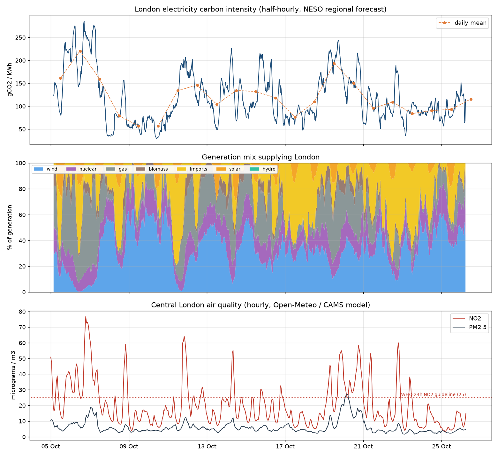
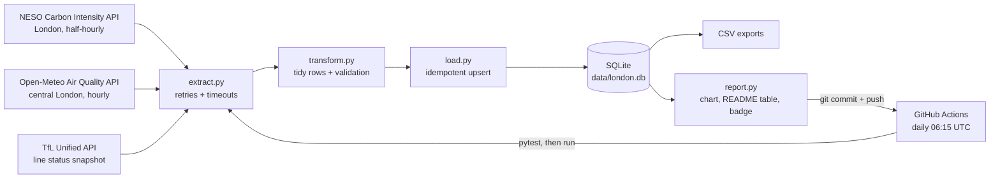

# London Daily Data Pipeline

**An automated ETL pipeline that collects London's electricity carbon intensity, air quality and Tube status every day, stores it in SQLite, tests it, and publishes a refreshed chart and summary through GitHub Actions.**

*Anthony Adusei-Poku · MSc Data Science, University of East London (2025)*

    

## Latest data (updated automatically)

The section below is rewritten by the pipeline on every run. Times are UTC.

<!-- LATEST:START -->
_Last updated by the pipeline: **2026-10-26 06:55 UTC** · 12 runs · 1,013 half-hours of carbon data since 05 Oct 2026, 511 hours of air quality, 12 TfL snapshots_

| Measure | Latest | Last 7 days |
|---|---|---|
| Grid carbon intensity, London (gCO2/kWh) | **115** (moderate, 26 Oct 05:30 UTC) | mean 115.2 |
| Cleanest / dirtiest half-hour | | 36 (Fri 23 Oct 03:30) / 244 (Mon 19 Oct 17:30) |
| Lowest-carbon / highest-carbon hour of day (UTC, 7-day average) | | 03:00 / 17:00 |
| Wind / gas share of generation | | 35.2% / 17.0% |
| NO2, central London (µg/m3) | 14.9 (26 Oct 06:00 UTC) | mean 19.9 |
| PM2.5, central London (µg/m3) | 4.9 | mean 6.7 |
| TfL lines with Good Service | 15 of 19 (26 Oct 06:55 UTC) | |
| TfL disruptions at last snapshot | Circle: Part Suspended, District: Part Suspended, Northern: Severe Delays, Suffragette: Part Suspended | |

<p align="center"></p>
<!-- LATEST:END -->

## TL;DR

* A Python pipeline pulls **three free public APIs with no keys**: the NESO Carbon Intensity API (London region), the Open-Meteo air quality API (central London) and the TfL Unified API (19 Tube, Elizabeth line, Overground and DLR lines).
* Data is **validated** (range checks, generation mix sums to 100%, no negative concentrations), **upserted idempotently** into SQLite (re-running a day never duplicates rows) and exported to CSV.
* A **GitHub Actions workflow runs every day at 06:15 UTC**: it runs the tests, runs the ETL, regenerates the chart, the README table and a live badge, and commits the changes.
* **11 unit tests** run against real API responses saved as fixtures.
* First run (backfill, 5 to 19 Oct 2026): **673 half-hours** of carbon data and **341 hours** of air quality. Over that period London's grid averaged **120.7 gCO2/kWh**, and carbon intensity was strongly linked to the wind: **78.1 gCO2/kWh when wind supplied at least 40%** of generation vs **142.8** otherwise (correlation with wind share -0.73).

## 1. Why this project

Analyst jobs increasingly expect people to own their data, not just analyse a CSV someone hands them. This
project shows the engineering side: scheduled extraction from APIs, validation, a small warehouse, tests, CI/CD
and automated reporting, all on free infrastructure.

## 2. Architecture



| Table | Grain | Key | Source |
|---|---|---|---|
| `carbon_intensity` | half-hour | `period_start` | forecast gCO2/kWh, index band, % generation for 9 fuels |
| `air_quality` | hour | `hour` | PM10, PM2.5, NO2, ozone (µg/m3), European AQI |
| `tfl_line_status` | line per snapshot | `snapshot_at`, `line_id` | worst current status and reason |
| `pipeline_runs` | run | `run_at` | rows fetched per source, status, error messages |

**Design choices**
* **Idempotent loads:** each daily run re-fetches a 2-day window and upserts on the primary key, so a missed or repeated run heals itself and revised values overwrite old ones.
* **Fault isolation:** each source runs independently. If one API is down the run is logged as `partial` and the other sources still load; the job only fails if every source fails.
* **Validation before load:** implausible values raise errors instead of silently entering the database.
* **Small, diffable outputs:** SQLite plus CSV exports grow by roughly 100 rows a day, so committing them is cheap and every change is visible in git history.

## 3. Findings from the first two weeks (5 to 19 Oct 2026)

Generated with `python -m pipeline.insights` on the backfilled data:

| Finding | Value |
|---|---|
| Mean carbon intensity of London's electricity | 120.7 gCO2/kWh (range 30 to 286) |
| Mean when wind is at least 40% of generation | **78.1** gCO2/kWh (230 half-hours) |
| Mean when wind is below 40% | **142.8** gCO2/kWh (443 half-hours) |
| Correlation of intensity with wind share / gas share | -0.73 / +0.93 |
| Cleanest / dirtiest hour of the day (UTC, average) | 12:00 (86.0) / 17:00 (158.7) |
| Mean NO2, central London (modelled) | 20.7 µg/m3, peak 76.7 at 19:00 UTC on 6 Oct |
| Full days with mean NO2 above the WHO 24-hour guideline (25 µg/m3) | 4 of 14 |
| Worst hour of day for NO2 (UTC, average) | 19:00 (32.5 µg/m3) vs 13:00 (11.0) |

**What it means:** gas sets the carbon intensity of London's power, and wind displaces it. Midday (solar plus
lower demand) is the cleanest time to run flexible loads such as EV charging, and the early-evening peak is the
dirtiest. Evening rush hour is also when NO2 builds up.

## 4. Data sources and licences

| Source | What | Licence |
|---|---|---|
| [NESO Carbon Intensity API](https://carbonintensity.org.uk/) | Regional (London) half-hourly forecast intensity and generation mix | [CC BY 4.0](https://github.com/carbon-intensity/terms) |
| [Open-Meteo Air Quality API](https://open-meteo.com/en/docs/air-quality-api) | Hourly modelled pollutants for central London (CAMS European model) | [CC BY 4.0](https://open-meteo.com/en/license) |
| [TfL Unified API](https://api.tfl.gov.uk/) | Live line status | Powered by TfL Open Data. Contains OS data © Crown copyright and database rights 2016 and Geomni UK Map data © and database rights 2019 |

## 5. How to run

```bash
git clone <this-repo> && cd london-data-pipeline
python -m venv .venv && source .venv/bin/activate
pip install -r requirements.txt
python -m pytest -q                       # 11 tests, offline (uses saved API responses)
python -m pipeline.run                    # daily run: last 2 days + TfL snapshot
python -m pipeline.run --days 14          # backfill up to 14 days
python -m pipeline.insights               # summary statistics
```

**Automation:** push to GitHub and the `Daily London ETL` workflow runs on schedule (06:15 UTC) or on demand from
the Actions tab (with an optional lookback in days). It needs no secrets: it uses the built-in `GITHUB_TOKEN` with
`contents: write` permission to commit the refreshed data.

## 6. Limitations and next steps
* Carbon intensity values are NESO's regional **forecasts**; the API does not publish regional actuals.
* Air quality is **modelled** (CAMS) for one point, not measured at roadside monitors. The London Air Quality Network would add measured data.
* TfL status is one snapshot per run, so it is a sample of service quality, not a full disruption log. Running the workflow every 15 minutes would fix this.
* GitHub pauses scheduled workflows in repositories with no activity for 60 days.
* Next: move storage to DuckDB or Postgres, add data-quality alerts (for example, open an issue when a source fails twice), and publish a small Streamlit dashboard.

## Repository structure
```
london-data-pipeline/
├── pipeline/
│   ├── config.py      # endpoints, location, paths
│   ├── extract.py     # API calls with retries
│   ├── transform.py   # tidy rows + validation
│   ├── load.py        # SQLite schema, idempotent upsert, CSV export
│   ├── report.py      # chart, README section, badge
│   ├── insights.py    # summary statistics
│   └── run.py         # CLI entry point
├── tests/             # 11 pytest tests + real API fixtures
├── data/london.db     # the database (updated daily)
├── data/exports/      # CSV copies of every table
├── docs/              # latest.png chart + badge.json
└── .github/workflows/ # daily-etl.yml (cron) and tests.yml (CI)
```

## Skills shown
Python ETL · REST APIs · data validation · SQL and SQLite · idempotent loading · unit testing (pytest) · CI/CD with
GitHub Actions (cron scheduling, automated commits) · automated reporting · data visualisation.
